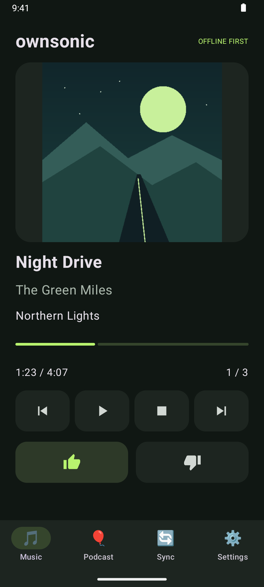
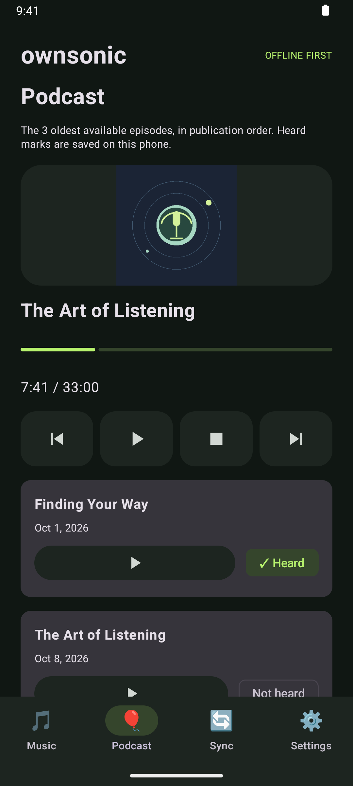
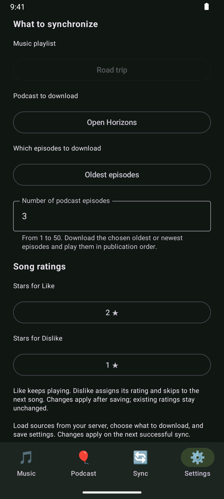

# Ownsonic

An offline Android music and podcast player for reviewing an Airsonic playlist while traveling without reliable internet access.

[**Download APK**](https://github.com/dimarys/Ownsonic/releases/latest) · [All releases](https://github.com/dimarys/Ownsonic/releases)

Requires Android 8.0 or newer. Download the signed release APK from the release assets and open it on your phone to install.

## Screenshots

<p>
  
  
  
</p>

English interface shown with fictional demo media, sample server settings, and original sample artwork.

## License

Copyright (C) 2026 Dmitry Rys.

Ownsonic's original code, documentation, and artwork are licensed under the GNU General Public License, version 3 only (`GPL-3.0-only`). You may use, modify, and redistribute them under the terms of [LICENSE](LICENSE). They are provided without warranty, to the extent permitted by law.

Third-party components retain their respective licenses and copyright notices. See [THIRD_PARTY_NOTICES.txt](THIRD_PARTY_NOTICES.txt) and [legal/](legal/) for their attributions and full license texts. Every APK includes these files and Ownsonic's GPL text under `assets/legal/`. The project license does not cover music, podcast episodes, or artwork downloaded from a user's server.

The [licensing review](docs/licensing-review.md) and [dependency inventory](docs/license-dependencies.csv) document compatibility findings and remaining public-distribution requirements, including corresponding source and test-bundle licensing. When changing dependencies or third-party assets, update the inventory and notices together. Legal assets are copied from the checked-in files during the build; this step does not access the network.

## First run

1. Install the APK on a device running Android 8.0 or newer.
2. Open **Settings** and enter the Airsonic base URL (including its context path, if any), username, and password.
3. Tap **Check connection and load sources**. Choose a music playlist from the server. Optionally choose a podcast and an episode count from 1 to 50, or leave **No podcast** selected.
4. Save settings, then open **Sync** and tap **Sync** while connected to the server.
5. Open **Music** or **Podcast** and press Play. Downloaded audio works offline.

The selected playlist and podcast are stored by server ID, so duplicate names and renames do not change the selected source. Source changes apply on the next successful sync; existing queues and pending ratings remain intact until then. Podcasts are optional, including on music-only servers. Existing installations retain the `laterlist` playlist, podcast channel `7`, and five-episode limit until changed in Settings. Fresh installations start with podcasts disabled.

Like keeps playing; Dislike advances. Each button has its own rating from one to five stars in Settings, defaulting to two for Like and one for Dislike. Saving these choices does not change existing or pending song ratings. Previous returns to the previous song so its rating can be corrected. Stop resets the current song to its beginning; Pause retains its position. The queue stops at its end.

Tap the playback progress bar to seek to that point in the current song. Seeking preserves whether playback is paused or playing.

The Player screen displays embedded cover art from the downloaded audio file, including offline. Files without readable cover art display the music note instead.

Enable **Rating reminder** in Settings to hear a brief beep on the media audio stream when an unrated song has 20 seconds remaining. It is disabled by default, works during background playback, and does not pause the music. It plays once per listening session; pausing or seeking within the song does not repeat it, while restarting from the beginning resets it. Songs lasting 20 seconds or less do not trigger a reminder. The beep follows the device's media volume and audio route.

Each successful sync uploads pending local ratings and completed listens, excludes songs with any nonzero rating, downloads missing unrated songs, and creates a new fixed shuffled queue. Local copies of rated songs and songs no longer in the playlist are removed after successful sync; the server playlist is unchanged. Sync resets playback to the first song without starting it. Failed syncs preserve the queue and listening progress; unconfirmed ratings and listens remain pending.

Download progress counts completed songs across the current batch, excluding files already stored locally. The bar advances after each successful download; rating uploads and playlist retrieval use an indeterminate indicator.

Enable **Automatic synchronization** in Settings for daily Wi-Fi-only sync. It is disabled by default. The 23:30 run synchronizes only when local ratings or completed listens are waiting to upload; the 05:00 run refreshes the playlist regardless of pending changes. Both use the phone's local time, wait while music is playing, and share the normal Sync status screen. Android may delay execution until network and battery conditions permit. Automatic requests bind their connections to Wi-Fi so downloads cannot fall back to cellular data. Disabling the option cancels scheduled and pending automatic work; manual Sync remains available.

## Offline scrobbling

Songs that finish naturally are queued for scrobbling. Each event uses the original playback start time. Pauses and buffering do not count as listening time. Songs must be longer than 30 seconds and actually played for half their duration or four minutes, whichever is shorter. Skipping, disliking, stopping, or seeking to the end does not create a listen; restarting from the beginning starts a new session.

Sync sends pending events to Airsonic in timestamp order before refreshing the playlist. Configure Last.fm integration in the Airsonic user's settings to enable forwarding. Server confirmation acknowledges receipt by Airsonic, rather than final Last.fm delivery. Pending events and active listening sessions survive app restarts. A lost server response can cause a duplicate on retry because the Subsonic API does not provide an idempotency key.

## Build and install

Open the repository in Android Studio and let Gradle sync complete. Install the SDK requested by the project through SDK Manager. Use the bundled Android Studio JDK (the Gradle daemon configuration specifies Java 25).

From a terminal with `JAVA_HOME` configured:

```sh
./gradlew assembleDebug
./gradlew installDebug
```

The APK is written to `app/build/outputs/apk/debug/app-debug.apk`. Enable USB debugging on the phone and authorize your computer before installing over USB. You can also select the device in Android Studio and press Run.

## Signed release APK

The local release signing configuration lives in `.signing/release.properties`, and the private key is `.signing/ownsonic-release.p12`. Both are excluded from Git. Back up the entire `.signing` directory securely: future releases must use the same key to update an installed release without uninstalling it.

```sh
./gradlew assembleRelease lintRelease
```

The signed output is `app/build/outputs/apk/release/app-release.apk` when the local signing configuration is present. Without it, the release output is unsigned and cannot be installed as delivered.

A release signed with this key cannot replace the original debug build because their certificates differ. Sync any pending ratings and listens, then uninstall the debug build before installing the release. Uninstalling clears local app data.

## Validation

```sh
./gradlew testDebugUnitTest lintDebug
./gradlew connectedDebugAndroidTest
```

Instrumented tests require a connected emulator or test device. They exercise synchronization against a local fake Subsonic server, rating conflicts, failed uploads and downloads, removal, persistence, encrypted credentials, and player controls. The player UI test seeds a test library; run it on an emulator or a disposable app installation.

## Implementation

- Kotlin and Jetpack Compose for the four app screens.
- Media3 ExoPlayer and MediaSessionService for local playback, media notifications, audio focus, and headset controls.
- WorkManager foreground work for manual synchronization that can continue after leaving the screen.
- Subsonic REST API with salted token authentication.
- App-private audio storage, an atomic library file, and saved playback position.
- Separate Compose screen files and shared playback components. UI writes await completion on the IO dispatcher; Media3 callbacks queue ordered background writes with revision guards.
- Stable message codes and parameters for worker progress and application errors. A compatibility reader handles text-only progress records from older installations.
- Android Keystore encryption for the stored password. Android backup is disabled.

The interface supports English and Russian and follows the phone language. On Android 13 and later, the language can also be selected in the system settings for Ownsonic. Song and artist metadata, playlist names, and server addresses remain unchanged.

The Podcast screen plays the configured number of oldest or newest available episodes from the selected server podcast, including already-heard episodes. Choose **Oldest episodes** or **Newest episodes** in Settings (oldest by default). The chosen episodes always play in publication order, with a local heard mark set on natural completion or changed manually. Sync downloads original audio from episodes already downloaded on Airsonic, removes stale local copies, and preserves the current episode position. Music and podcast playback have separate bookmarks; podcasts do not create Last.fm scrobbles or rating reminders.

Sync also caches podcast artwork from the server for offline display. An episode's own artwork takes precedence over the channel artwork. Shared images are downloaded once per sync, refreshed on later syncs, and removed when no retained episode references them. Failed artwork downloads preserve any cached image and do not fail audio synchronization. If server artwork is unavailable, the Podcast screen tries the audio file's embedded cover and then displays the music note.

## Local data recovery

If the library cannot be read, the app opens a recovery screen and blocks synchronization and library changes. **Try reading again** reloads a repaired file without resetting pending ratings or listens. **Reset local library** requires confirmation and replaces the damaged data with an empty library. Connection settings and downloaded audio are retained; the next sync can reuse complete audio files. Pending ratings and listens from the damaged library cannot be recovered by a reset.

An unreadable saved password produces a localized error and can be replaced in Settings without clearing the library. A malformed in-progress listening session is ignored; already-queued scrobbles remain in the library.

## Current limitations

- One server account per local library. To change the server or username after syncing, clear the app's storage in Android Settings first. Upload pending ratings before doing so.
- Downloads use original audio files; server transcoding is not implemented. Format support depends on Android and ExoPlayer.
- Downloads interrupted mid-file restart on the next sync; completed downloads are reused.
- Use a trusted HTTPS endpoint when available. HTTP endpoints are supported for local Airsonic installations.
- Real Airsonic connectivity and physical headset behavior must also be verified on the user's device.

See [SPECIFICATION.md](SPECIFICATION.md) for the agreed requirements and [AGENTS.md](AGENTS.md) for project conventions.
